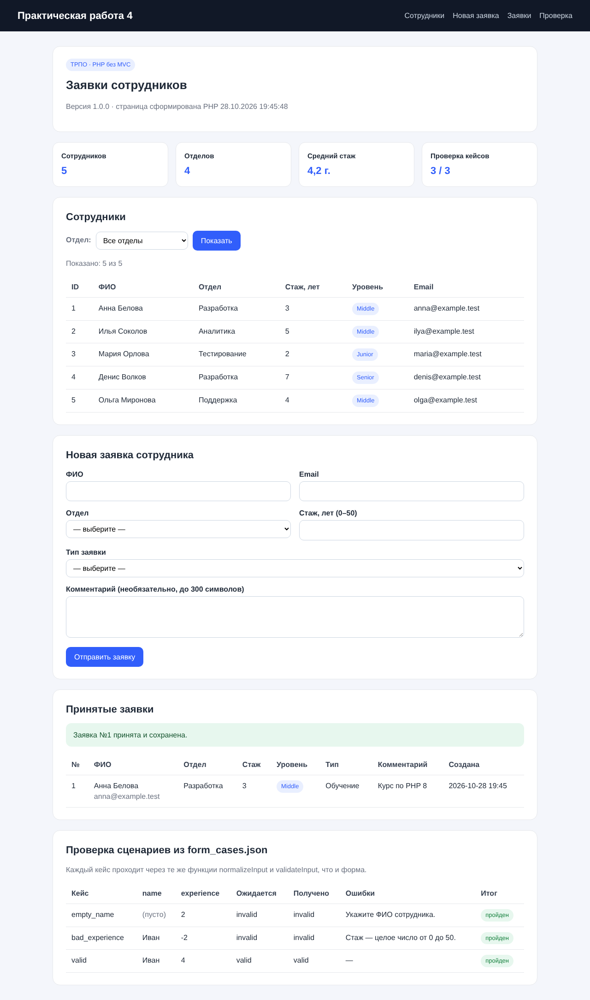
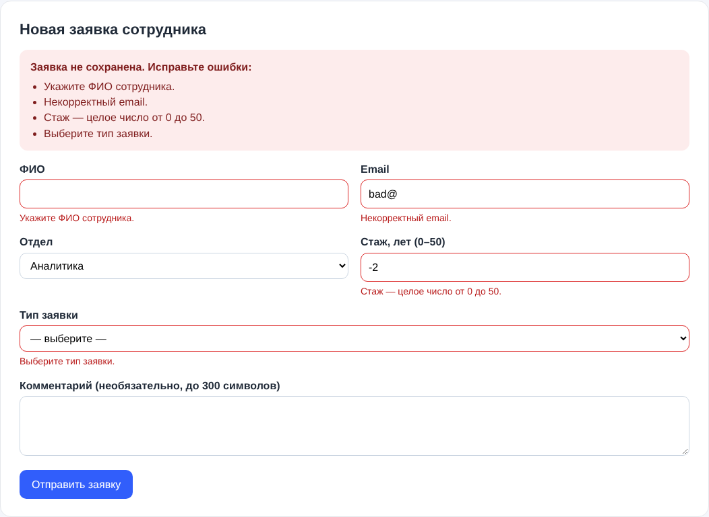

# Практическая работа №4 — «Заявки сотрудников»

**Дисциплина:** Технологии разработки программного обеспечения
**Тема:** PHP. Основы языка, запросы и обработка HTML-форм

Небольшое PHP-приложение без MVC и без фреймворков. Оно:

- читает `employees.csv` и выводит таблицу сотрудников;
- фильтрует таблицу по отделу через GET-параметр `department`;
- принимает заявку сотрудника через POST-форму (6 полей), нормализует и валидирует данные на сервере;
- при ошибке показывает сообщения возле полей и сохраняет введённые значения;
- сохраняет корректные заявки в `data/requests.json` и выводит их таблицей с вычисленными полями;
- прогоняет сценарии из `form_cases.json` через ту же валидацию и показывает итог проверки.





## Требования к окружению

- PHP **8.1+** (используются `match`, `mixed`, стрелочные функции, `array_key_first`);
- расширение `mbstring` (`mb_strlen`, `mb_strtolower`) — обычно включено по умолчанию;
- Apache/nginx и база данных **не нужны**.

Проверить версию: `php -v`

## Запуск

```bash
git clone <ссылка-на-репозиторий> trpo-pr04-student
cd trpo-pr04-student
php -S localhost:8000 -t public
```

Открыть в браузере: **http://localhost:8000**

Флаг `-t public` делает корнем сайта папку `public`, поэтому `src/` и `data/` недоступны из браузера напрямую.

## Структура каталогов

```
trpo-pr04-student/
├── public/                 # корень веб-сервера
│   ├── index.php           # точка входа: обработка запроса + HTML-шаблон
│   └── assets/style.css    # стили
├── src/
│   └── functions.php       # функции обработки данных (без HTML)
├── data/                   # копия dataset работы
│   ├── employees.csv       # сотрудники (разделитель «;»)
│   ├── form_cases.json     # сценарии проверки формы
│   └── requests.json       # создаётся при первой заявке, в .gitignore
├── docs/screenshot.png
├── .gitignore
└── README.md
```

## Используемые данные (dataset)

| Файл | Поля | Как используется |
|------|------|------------------|
| `employees.csv` | `id; name; department; experience; email` | таблица сотрудников, список отделов для формы и фильтра, статистика |
| `form_cases.json` | `case, name, experience, valid` | автоматическая проверка валидации в разделе «Проверка» |

`id` используется как устойчивый идентификатор, `name` — только для вывода. Из `experience` вычисляется уровень: < 3 лет — Junior, 3–5 — Middle, 6+ — Senior.

## Функции в `src/functions.php`

| Функция | Назначение |
|---------|-----------|
| `e()` | экранирование через `htmlspecialchars(..., ENT_QUOTES, 'UTF-8')` |
| `loadEmployees()` | чтение CSV через `fgetcsv`, пропуск пустых строк и BOM |
| `mapEmployeeRow()` | одна строка CSV → ассоциативный массив с типами и полем `level` |
| `departmentsOf()`, `averageExperience()` | список отделов, средний стаж |
| `normalizeInput()` | берёт нужные поля через `??`, применяет `trim`, массив вместо строки → `''` |
| `validateInput()` | серверная валидация, возвращает массив ошибок `['поле' => 'сообщение']` |
| `saveRequest()`, `loadRequests()`, `buildRequest()` | сохранение и чтение заявок в JSON |
| `filterByDepartment()` | фильтр по GET-параметру |
| `loadFormCases()`, `runFormCases()` | проверка сценариев из `form_cases.json` |

Файл подключается в `index.php` через `require_once`.

## Правила валидации формы

| Поле | Правило |
|------|---------|
| ФИО (`name`) | обязательно; после `trim` от 2 до 60 символов (`mb_strlen`) |
| Email (`email`) | обязательно; `FILTER_VALIDATE_EMAIL` |
| Отдел (`department`) | обязательно; только значение из `employees.csv` |
| Стаж (`experience`) | обязательно; целое число 0–50 (`FILTER_VALIDATE_INT` с `min_range`/`max_range`) |
| Тип заявки (`type`) | одно из: отпуск, оборудование, обучение, перевод |
| Комментарий (`comment`) | необязательно; не длиннее 300 символов |

У формы стоит `novalidate`: HTML-атрибуты `required`/`min`/`max` оставлены как подсказка, но браузерную проверку легко обойти, поэтому решает именно сервер — это и демонстрирует работа.

## Сценарий проверки

| № | Вход | Ожидаемый результат | Итог |
|---|------|---------------------|------|
| 1 | открыть `/` | версия приложения и текущая дата из PHP, таблица из 5 сотрудников | ✅ |
| 2 | `/?department=Разработка` | 2 записи (Анна Белова, Денис Волков) | ✅ |
| 3 | `/` без параметра / кнопка «Сбросить» | все 5 записей | ✅ |
| 4 | `/?department=<b>XX` | сообщение «отдел не найден» (тег выведен текстом), показаны все | ✅ |
| 5 | форма: ФИО из одних пробелов | «Укажите ФИО сотрудника.», остальные значения сохранены в полях | ✅ |
| 6 | форма: email `bad@` | «Некорректный email.» | ✅ |
| 7 | форма: стаж `-2` | «Стаж — целое число от 0 до 50.» | ✅ |
| 8 | форма: ФИО `<script>alert(1)</script>`, остальное корректно | заявка сохранена, в таблице показан текст `<script>…`, скрипт не выполняется | ✅ |
| 9 | POST с `name[]=x` (массив вместо строки) | сообщение об ошибке, без PHP warning | ✅ |
| 10 | раздел «Проверка»: `empty_name`, `bad_experience`, `valid` | invalid, invalid, valid — все 3 кейса «пройден» | ✅ |

Для кейсов из `form_cases.json` заданы только `name` и `experience`, поэтому остальные поля подставляются заведомо корректными — так проверяется именно поле кейса.

## Изменения после шагов 12 и 13

- **Шаг 12.** Вся обработка (чтение CSV, нормализация, валидация, сохранение) вынесена из `index.php` в `src/functions.php` и подключается через `require_once`. В `index.php` остались только вызовы функций и HTML-шаблон.
- **Шаг 13.** Добавлена GET-форма с параметром `department` и функция `filterByDepartment()`. Без параметра или с неизвестным отделом выводятся все записи; значение параметра экранируется при выводе.

## Ошибки PHP

В начале `index.php` включено `error_reporting(E_ALL)`, а `display_errors` включается только при запуске встроенным сервером или на `localhost`. На «боевом» сервере ошибки пишутся в лог и не показываются пользователю. Во время проверки сценариев предупреждений и notice нет.

## GET и POST

| | GET | POST |
|---|-----|------|
| Где данные | в URL: `/?department=Аналитика` | в теле HTTP-запроса |
| В PHP | `$_GET` | `$_POST` |
| Для чего | чтение, фильтры, поиск — запрос не меняет данные, ссылку можно сохранить | отправка формы, создание записей — запрос меняет состояние |
| Повтор | безопасно обновлять страницу | при обновлении браузер предложит отправить повторно |
| В работе | фильтр по отделу, `?saved=N` | форма заявки |

После успешного POST выполняется редирект `303 See Other` на `/?saved=N` (шаблон Post/Redirect/Get), поэтому обновление страницы не создаёт дубликат заявки.

## Зачем нужен htmlspecialchars

Функция заменяет спецсимволы на HTML-сущности: `<` → `&lt;`, `>` → `&gt;`, `&` → `&amp;`, `"` → `&quot;`, `'` → `&#039;` (флаг `ENT_QUOTES`). Без этого пользователь может ввести `<script>…</script>` и браузер выполнит его у всех, кто откроет страницу (XSS), или разорвать атрибут `value="..."` кавычкой. В приложении все данные, пришедшие от пользователя или из файлов, выводятся через обёртку `e()`. Экранирование делается **при выводе**, а в файл сохраняются исходные значения.

## Путь данных от формы до HTML-ответа

1. Пользователь заполняет форму, браузер отправляет `POST /` с полями в теле запроса.
2. Встроенный сервер PHP передаёт запрос в `public/index.php`, данные попадают в `$_POST`.
3. `normalizeInput($_POST)` берёт нужные поля через `??` (нет поля → `''`) и применяет `trim`.
4. `validateInput()` проверяет значения и возвращает массив ошибок.
5. **Есть ошибки** → тот же `index.php` формирует HTML: список ошибок сверху, сообщение у каждого поля, введённые значения через `e()` в `value` / `selected`.
6. **Нет ошибок** → `saveRequest()` дописывает заявку в `data/requests.json` (с полем `level` и датой) и отправляет редирект на `/?saved=N`.
7. На GET-запросе `loadRequests()` читает файл, а шаблон выводит таблицу заявок, экранируя каждое значение через `e()`.

## История коммитов

```
chore: структура проекта, dataset и .gitignore
feat: чтение employees.csv и таблица сотрудников
feat: форма заявки сотрудника с серверной валидацией
feat: GET-фильтр по отделу и проверка кейсов form_cases.json
docs: README с инструкцией запуска, GET/POST и путём данных
```
